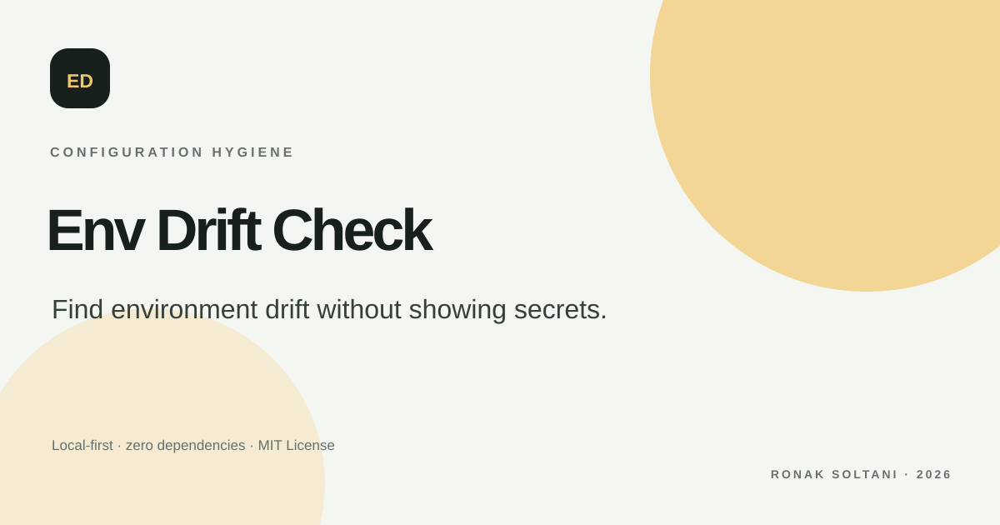

# Env Drift Check

> CONFIGURATION HYGIENE · LOCAL-FIRST DEVELOPER TOOL

Compare an example env file with a local environment snapshot. See missing, extra and duplicate key names while keeping every value out of the report.

A complete, dependency-free portfolio project by **Ronak Soltani**. It is designed as a usable browser tool with a clear privacy boundary and no backend dependency.

## Why this project

The project turns a common engineering review into a small workflow that can be inspected and repeated. Its rules, assumptions and limits are documented in the interface and in this README.

## Features

- Compare .env.example and current key sets
- Find missing, unexpected and duplicate names
- Copy blank placeholders for missing keys
- Never display or persist environment values

## Run locally

1. Clone or download this repository.
2. Open index.html in a modern browser.
3. If your browser restricts local file access, run python -m http.server 8000 from this folder and open http://localhost:8000.

No package manager, build step, account or API key is required. The app uses browser-native JavaScript and CSS.

## Privacy and data handling

The application code makes no network requests. Input is processed in memory in the current tab and is not written to local storage. A selected file, if supported by the tool, is read by the browser only. Avoid using data you are not authorized to inspect.

## Scope

Paste only data you are authorized to inspect. The app parses key names and discards values from its report; it does not edit files or validate whether a value is correct.

All sample names, settings, prompts, traces, API documents, CSV rows, environment values, container files, commits and prices are fictional examples. Prices in the budget tool are editable assumptions, not a live price list.

## Project files

- index.html — accessible page structure, controls and sample content.
- styles.css — responsive layout, color system and focus/reduced-motion states.
- app.js — compare .env.example and current key sets.
- preview.svg — original social preview and SVG favicon.
- PROJECT-PLAN.md — brief, interaction flow, boundaries and learning goals.
- CONTRIBUTING.md — contribution guidance.

## Deploy with GitHub Pages

Open Settings → Pages, choose Deploy from a branch, select main and the root folder, then save. This static site has no build step.

## License

Released under the MIT License. See LICENSE.
